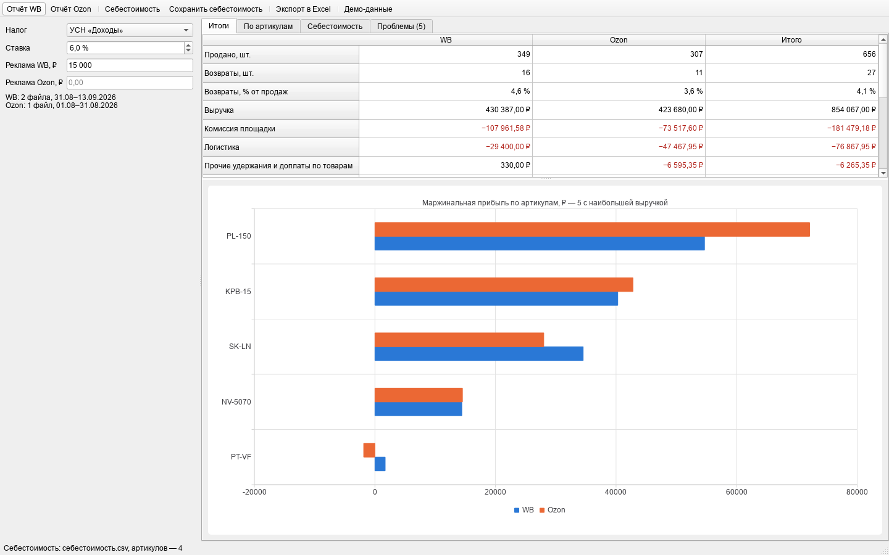
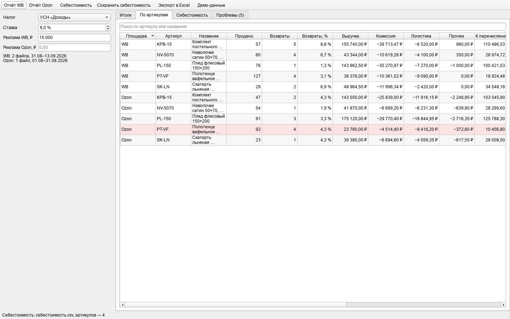
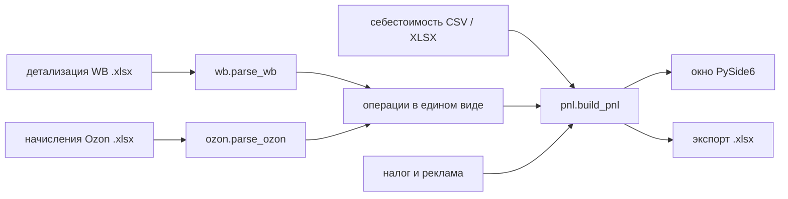

# seller-unit-economics — юнит-экономика по отчётам WB и Ozon

Настольное приложение для селлера: открываете еженедельные детализации Wildberries и отчёт о начислениях Ozon, задаёте себестоимость, налог и рекламу — видите прибыль по каждому артикулу и по обеим площадкам и выгружаете всё в Excel. Считается по-честному: возвраты вычитаются, количество из отчёта учитывается, а всё, что программа не распознала, попадает в список «Проблемы», а не растворяется в итогах.



## Что показывает

Сводка читается сверху вниз, как P&L:

| Строка | Откуда берётся |
|---|---|
| Продано и возвраты, шт. | «Кол-во» строк «Продажа» и «Возврат» у WB, «Количество» у строк доставки и возврата Ozon |
| Выручка | цена после скидки продавца × количество (WB), «За продажу или возврат…» (Ozon), возвраты с минусом |
| Комиссия площадки | у WB — разница между выручкой и «К перечислению», у Ozon — «Комиссия за продажу» |
| Логистика | «Услуги по доставке товара покупателю» и возмещение издержек (WB); магистраль, последняя миля, обратная логистика и обработка (Ozon) |
| Прочие удержания и доплаты | штрафы, доплаты, компенсации брака (WB); эквайринг и всё, что не попало в другие колонки (Ozon) |
| К перечислению за товары | сумма четырёх строк выше |
| Себестоимость проданного | себестоимость × (продано − возвращено) |
| Маржинальная прибыль | к перечислению минус себестоимость |
| Общие расходы площадки | строки без артикула: хранение, платная приёмка, услуги размещения, продвижение |
| Реклама | вводится вручную: в отчёт WB она не попадает, а у Ozon приходит отдельными строками услуг |
| Налог и чистая прибыль | УСН «Доходы» или «Доходы минус расходы», ставка настраивается |

По артикулам считаются возвраты в процентах, маржа, ROI и прибыль на единицу. Убыточные строки подсвечены, артикулы без себестоимости — отдельным цветом, чтобы завышенная прибыль сразу бросалась в глаза.



## Демо без своих отчётов

`unit-economics demo` создаёт синтетические отчёты (две недели WB и месяц Ozon), считает по ним и сохраняет Excel:

```text
WB: 31.08–13.09.2026, 2 файла · Ozon: 01.08–31.08.2026, 1 файл
                                                         WB                Ozon               Итого
Продано, шт.                                            349                 307                 656
Возвраты, шт.                                            16                  11                  27
Выручка                                        430 387,00 ₽        423 680,00 ₽        854 067,00 ₽
Комиссия площадки                             −107 961,58 ₽        −73 517,60 ₽       −181 479,18 ₽
Логистика                                      −29 400,00 ₽        −47 467,95 ₽        −76 867,95 ₽
Прочие удержания и доплаты по товарам              330,00 ₽         −6 595,35 ₽         −6 265,35 ₽
К перечислению за товары                       293 355,42 ₽        296 099,10 ₽        589 454,52 ₽
Себестоимость проданного                      −147 730,00 ₽       −140 530,00 ₽       −288 260,00 ₽
Маржинальная прибыль                           145 625,42 ₽        155 569,10 ₽        301 194,52 ₽
Общие расходы площадки                         −11 980,60 ₽         −4 230,40 ₽        −16 211,00 ₽
Прибыль до налога                              133 644,82 ₽        151 338,70 ₽        284 983,52 ₽
Налог                                          −25 823,22 ₽        −25 420,80 ₽        −51 244,02 ₽
Чистая прибыль                                 107 821,60 ₽        125 917,90 ₽        233 739,50 ₽
Рентабельность продаж                                25,1 %              29,7 %              27,4 %

Что проверить:
  • Не задана себестоимость: SK-LN — маржинальная прибыль по ним завышена
  • Убыточные артикулы (маржинальная прибыль меньше нуля): Ozon PT-VF
  • Периоды отчётов разные: WB 31.08–13.09.2026, Ozon 01.08–31.08.2026 — сравнивайте площадки с осторожностью
  • wb-детализация-2026-09-07.xlsx: неизвестное «Обоснование для оплаты» «Коррекция продаж» — строк: 1,
    к перечислению 350,00 ₽; учтено в прочих удержаниях и доплатах
  • ozon-начисления-2026-08.xlsx: неизвестный «Тип начисления» «Корректировка стоимости услуги» — строк: 1,
    итого 120,00 ₽; учтено в прочем
```

В демо у дешёвого полотенца (PT-VF) на WB прибыль есть, а на Ozon логистика и комиссия съедают всю маржу — на графике его столбец уходит влево. Файлы демо и готовая выгрузка лежат в [`examples/`](examples).

## Как запустить

```bash
uv sync
uv run unit-economics-gui                 # окно
uv run unit-economics-gui --demo          # окно сразу с демо-данными
uv run unit-economics demo --out examples # демо-файлы и отчёт без окна
uv run unit-economics report --wb неделя1.xlsx неделя2.xlsx --ozon август.xlsx \
    --costs себестоимость.csv --tax usn-profit --rate 15 --ads-wb "15 000" -o итог.xlsx
```

| Параметр `report` | Что делает |
|---|---|
| `--wb`, `--ozon` | файлы отчётов (.xlsx), можно по несколько |
| `--costs` | себестоимость: CSV (`;` или `,`) либо XLSX с колонками «Артикул» и «Себестоимость» |
| `--tax` | `usn-income` (по умолчанию), `usn-profit`, `none` |
| `--rate` | ставка налога, % (по умолчанию 6) |
| `--ads-wb`, `--ads-ozon` | расходы на рекламу за период: принимается и «15 000», и «1500,50» |
| `-o` | куда сохранить .xlsx |

Коды выхода: `0` — посчитано, `1` — не удалось записать файл (открыт в Excel), `2` — отчёт не прочитан или ошибка в параметрах.

## Как устроено



| Модуль | Ответственность |
|---|---|
| `columns.py` | ищет строку заголовков (у Ozon над ней есть название отчёта и период) и колонки по названиям: регистр, «ё» и лишние пробелы не важны |
| `money.py` | суммы из ячеек и полей ввода → копейки; целые копейки дают точную арифметику |
| `wb.py` | детализация WB → операции: знак «К перечислению» по «Типу документа», денежные колонки по формуле WB, неизвестные обоснования — в список проблем |
| `ozon.py` | начисления Ozon → операции: «Итого» строки считается истиной, «прочее» = Итого − выручка − комиссия − логистика, поэтому новые колонки не теряются |
| `pnl.py` | группировка pandas, себестоимость, налоги, выводы о проблемах |
| `export.py` | Excel: итоги, артикулы, общие расходы, проблемы; заливка убыточных строк |
| `gui/` | окно: `window.py` — виджеты и ввод, `models.py` — таблица артикулов с числовой сортировкой, `chart.py` — график прибыли |
| `demo.py` | синтетические отчёты в формате настоящих: лишние колонки, строка итогов у Ozon, неизвестные операции |

## Как читаются отчёты

- **WB.** Сумма к оплате = «К перечислению» за продажи и компенсации − «К перечислению» за возвраты − логистика − штрафы + доплаты − хранение − удержания − платная приёмка. Знак «К перечислению» берётся из «Типа документа». Строки без артикула (хранение, приёмка, удержания) идут в общие расходы площадки.
- **Ozon.** Каждая строка — начисление; «Итого» по строке считается итогом, остальные колонки раскладывают его на выручку, комиссию и логистику. Строка «Итого» внизу файла пропускается: у неё пустой «Тип начисления».
- **Налоги.** «Доходы» — от выручки по цене продавца за вычетом возвратов, считается по каждой площадке. «Доходы минус расходы» — только с общей прибыли, с минимальным налогом 1 % от доходов; в колонках площадок там стоит прочерк. Это оценка для управленческого учёта, а не бухгалтерский расчёт.
- **Себестоимость** списывается на чистые проданные единицы: возвращённый товар вернулся на склад. Если себестоимость не задана, она считается нулевой, но артикул попадает в «Проблемы».

## Как проверялось

- `ruff format`, `ruff check` (E, F, W, I, B, UP, S — bandit, C4, SIM, PT, RUF, DTZ) и `mypy --strict` проходят без замечаний.
- `pytest` — 65 тестов:
  - деньги и формат: числа из ячеек и полей ввода, мусор, склонения, вывод по-русски;
  - WB: возвраты, количество, компенсации, неизвестные обоснования, строки без артикула, английские имена полей из API, отсутствующие колонки, номер строки в сообщении об ошибке, .xls и битый файл;
  - Ozon: строки над заголовком, строка итогов внизу, баланс «Итого», отсутствие колонки «Количество», чужой отчёт;
  - себестоимость: CSV с «;» и «,», BOM, дубликаты, отрицательные значения, XLSX, сохранение и обратное чтение;
  - расчёт: маржа, ROI, прибыль на единицу, налоги в трёх режимах, минимальный налог 1 %, товар без продаж, предупреждения об убытках и разных периодах;
  - окно (offscreen): загрузка демо во все вкладки, переключение налога, независимая проверка полей рекламы, правка себестоимости в таблице, битый файл, поиск и числовая сортировка, экспорт, сохранение себестоимости между запусками;
  - демо: разбор сверяется с расчётом по формуле WB и со строкой «Итого» Ozon прямо по ячейкам — независимо от кода парсеров.
- Скриншоты в этом README сделаны запуском окна без экрана (`QT_QPA_PLATFORM=offscreen`) на тех же демо-данных.
- Выгрузка Excel открыта openpyxl: листы, числовые форматы, заливка убыточных строк.

### Не проверялось

- На настоящих выгрузках из кабинетов WB и Ozon приложение не проверялось: у меня нет доступа к кабинету продавца. Названия колонок WB взяты из публичных описаний отчёта, колонки Ozon — из публичных описаний формата. Если кабинет отдаст другие названия, приложение скажет, каких колонок не хватает, а не посчитает молча.
- Налоговая часть — оценка для управленческого учёта: минимальный налог УСН считается за период отчёта, а не за год, НДС и агентские тонкости не учитываются.
- Окно проверялось только на Windows и при масштабе экрана 100 %; на macOS и Linux не запускалось.
- Скорость на больших выгрузках не замерялась: в демо около 1 200 строк.

## Структура

```text
src/unit_economics/   columns, money, fmt, wb, ozon, costs, pnl, export, demo, cli
src/unit_economics/gui/   window, models, chart, app
tests/                money, wb, ozon, costs, pnl, demo, cli+export, gui
examples/             демо-отчёты WB и Ozon, себестоимость, выгрузка, скриншоты окна
```
